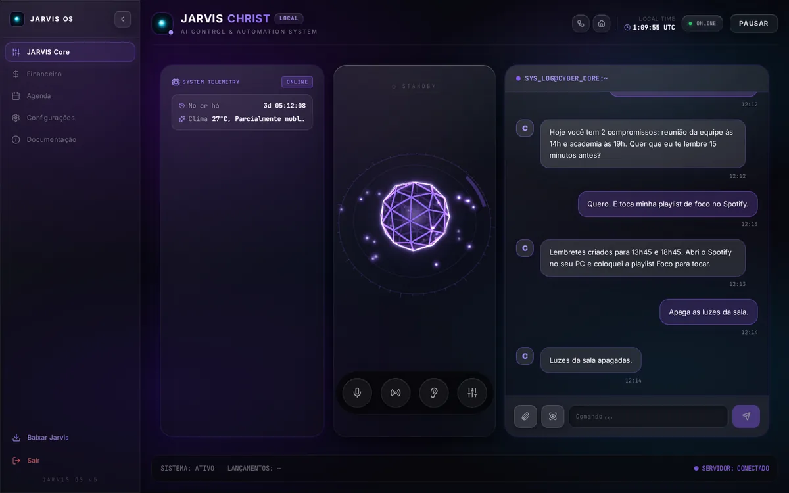
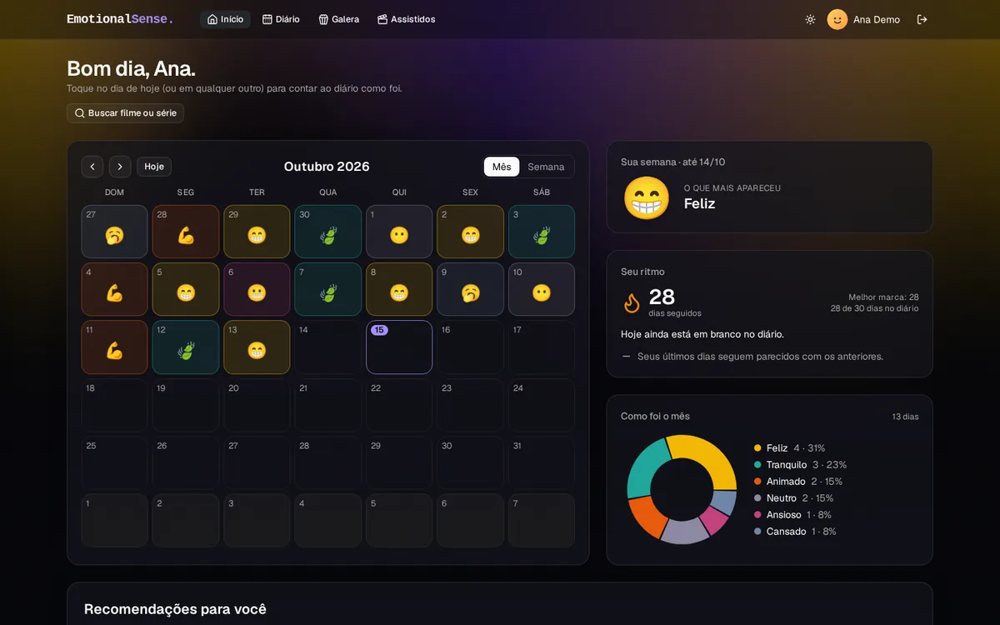
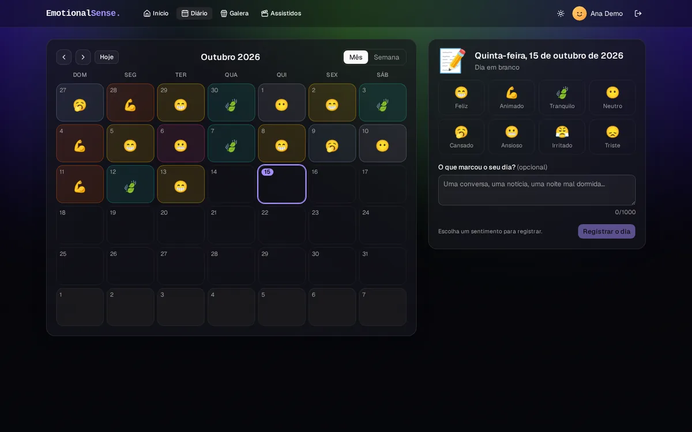
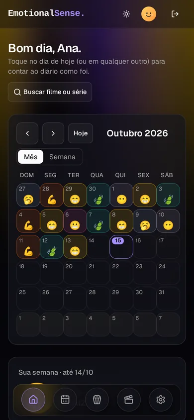
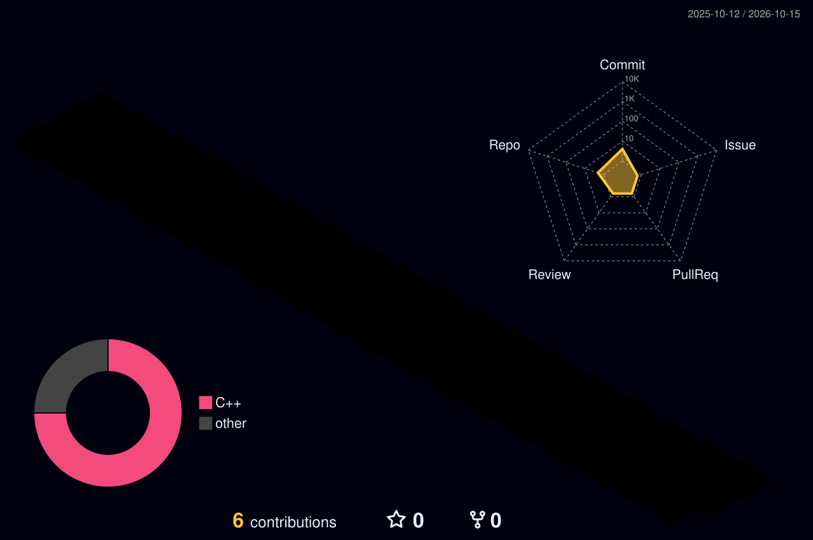

  

  
  
  

## 👋 Sobre mim

Estudante de **Engenharia da Computação na UVV** e estagiário de **Tecnologia** na GREEN Distribuição. Trabalho com
análise de dados e BI, desenvolvimento em **TypeScript, Java e SQL** e automações que colocam IA para conversar com as
ferramentas da empresa, usando **n8n** e **MCP (Model Context Protocol)**. Fora do trabalho, construo meus próprios
sistemas (um assistente pessoal completo e um diário de sentimentos com recomendações) e monto circuitos com
**Arduino** para projetos de robótica.

- 🔭 Hoje: dados, BI e automações com IA no estágio
- 🌱 Aprendendo: arquitetura de sistemas, agentes de IA e integrações com MCP
- 🤖 Hobby: robótica com Arduino
- 🗣️ Inglês avançado

## 🛠️ Tecnologias

   
  

  
  
  
  
  

## 💼 Experiência

| Período | Empresa | O que faço |
|---|---|---|
| 2025 – atual | **GREEN Distribuição Importação e Exportação** · Vitória/ES *Estágio de Tecnologia* | BI e análise de dados no Power BI (DAX), programação em SQL, Java e TypeScript, versionamento com Git, automações de processos com n8n e MCP integrando IA às ferramentas da empresa |
| 2024 – 2025 | **Transportadora Christ & Santos** · Vila Velha/ES *Estágio de Análise de Dados* | Análise de dados dos CT-e, controle de gastos (combustível e manutenção), prestação de contas aos clientes e validação do faturamento |

## 🚀 Projetos

<table>
  <tr>
    <td width="50%" valign="top">
      <h3>🟣 Jarvis</h3>
      
      
Assistente pessoal com IA que roda num servidor próprio: conversa por texto e voz ("Ei Jarvis"), controla a casa
      inteligente e o PC, cuida da agenda (Google Agenda) e das finanças (Open Finance), com app desktop e PWA.

      

        
        
        
        
        
        
      

      🔒 Código privado · tela com dados de demonstração
    </td>
    <td width="50%" valign="top">
      <h3>🌈 EmotionalSense</h3>
      
      
Diário de sentimentos: registre como foi o dia e acompanhe o mês no calendário e nos gráficos. O app recomenda
      filmes, séries e playlists de acordo com o humor e o gosto de cada pessoa.

      

        
        
        
        
        
      

      🔒 Código privado · conta de demonstração
    </td>
  </tr>
  <tr>
    <td width="50%" valign="top">
      
    </td>
    <td width="50%" valign="top" align="center">
      
    </td>
  </tr>
</table>

**🔌 Circuitos Lógicos e robótica com Arduino**: montagem e programação de circuitos (C/C++) e simulação de projetos.
Veja o repositório [CircuitosLogicos-Proj](https://github.com/Vinicius-Christ/CircuitosLogicos-Proj).

## 🎓 Formação

- **Engenharia da Computação**, Universidade de Vila Velha (UVV), desde 2024
- **Oracle Academy**: Database Foundations e Fundamentos de Java
- Participação em eventos de IA e dados na UVV (InovaWeek, InovaTalks, Databricks, IA para negócios)

## 📈 Atividade no GitHub

  <picture>
    <source media="(prefers-color-scheme: dark)" srcset="https://raw.githubusercontent.com/Vinicius-Christ/Vinicius-Christ/output/github-snake-dark.svg">
    <source media="(prefers-color-scheme: light)" srcset="https://raw.githubusercontent.com/Vinicius-Christ/Vinicius-Christ/output/github-snake.svg">
    
  </picture>

  <picture>
    <source media="(prefers-color-scheme: dark)" srcset="./profile-3d-contrib/profile-night-rainbow.svg">
    <source media="(prefers-color-scheme: light)" srcset="./profile-3d-contrib/profile-green-animate.svg">
    
  </picture>

